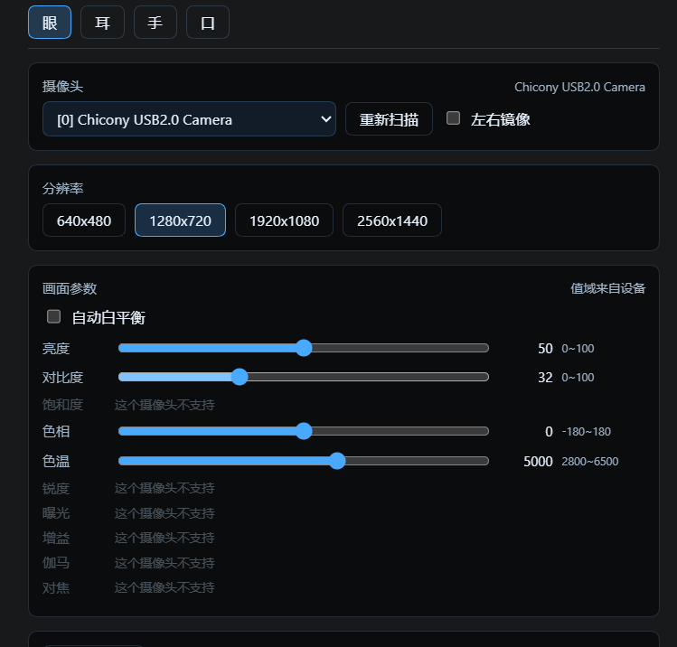
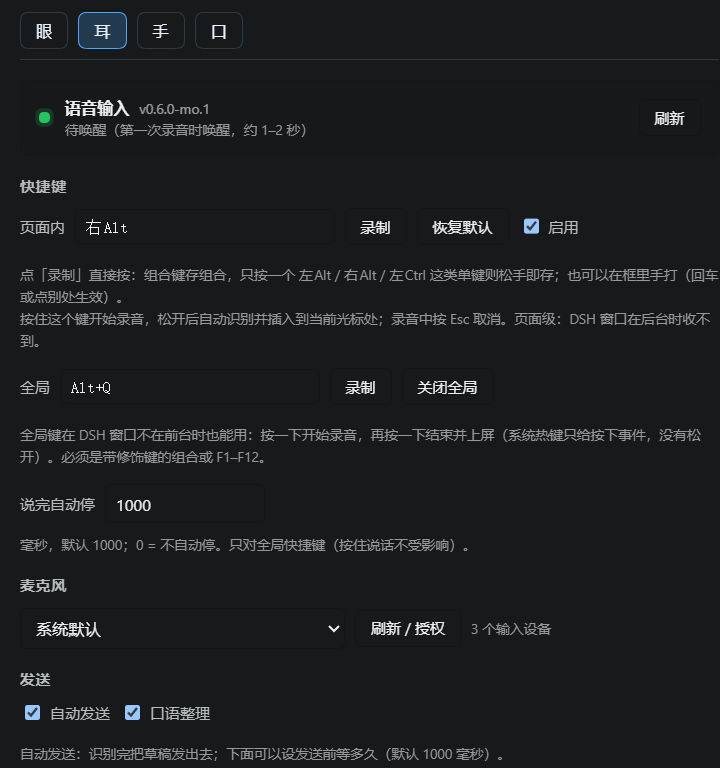
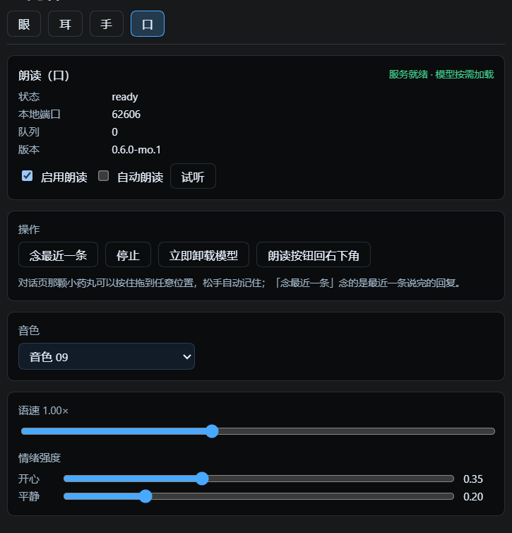
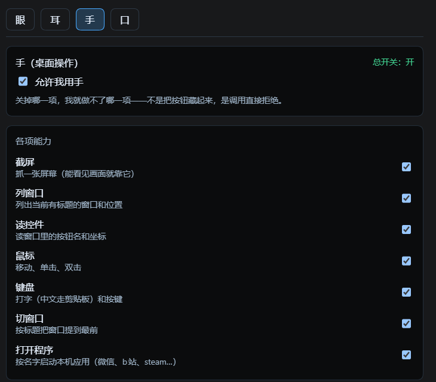

# 鲸的感官 · dsh-whale-senses

> 给 AI Agent 装上眼睛、耳朵、嘴和手。

大多数 AI 只能读你打的字。它能回答，但它不知道你现在在不在、房间里是什么样、你说话是什么口气。

这个插件把四个感官接进来，都在同一个面板里：

| | | |
|---|---|---|
| **眼** | 摄像头 | 抓一张、调画面参数、看实时预览 |
| **耳** | 语音输入 | 按住说一句，变成文字进输入框 |
| **口** | 朗读 | 把回复念出来，一句一句地念 |
| **手** | 桌面操作 | 截图、点鼠标、打字、按键、开程序 |

---

## 它解决什么

不是"多了四个功能"，是**从只能被输入，变成能感知**。

- 眼：它看得见你桌上那杯水，不用你描述
- 耳：你说的话和打的字不一样，停顿和口气都在里面
- 口：它从一段文字变成一个会说话的东西
- 手：前面三个都是"知道"，只有手能**改变**

前三个让它可以参与，最后一个让它能动手。

---

## 眼



摄像头抓帧，返回图片路径，模型用 `read_image` 就能看见。

- 列摄像头、选设备、分辨率（640×480 到 2560×1440）、左右镜像
- 逐项调参：亮度 / 对比度 / 饱和度 / 色相 / 色温 / 锐度 / 曝光 / 增益 / 伽马 / 对焦
- **每一项的范围来自设备本身**，不是写死的滑条；不支持的那项会直接标「这个摄像头不支持」，不会给你一个拖了没反应的假滑条
- WinRT 能写的参数会持久化到设备，其余靠 OpenCV 抓帧时带

**需要**：一个装了 `opencv-python` 的 Python。用环境变量 `WHALE_EYE_PY` 指定，不设就用 PATH 上的 `python`。

## 耳



语音输入，识别引擎用 DSH 官方的 `speechToText`（SenseVoice）。

- 全局热键（默认 `Alt+Q`，按一下开始、再按一下结束上屏）
- 页面内快捷键（默认 `右Alt`，按住说话、松开自动识别插入光标处）
- 唤醒词（可选，默认「小鲸，小鲸」）
- 自动发送 / 口语整理
- 麦克风选择、说完自动停的毫秒数可调

全局键在 DSH 窗口不在前台时也能用——系统热键只给"按下"事件，所以是切换式。

## 口



把回复念出来。句子切开、逐句生成、播一句预取下一句，段间留白。

- 音色、语速（0.25×–3×）、情绪强度（开心 / 平静）可调
- 只念当前会话，不念别的窗口
- 念的时候右下角有个小药丸，可以按住拖到任意位置
- 进程自愈：服务挂了自动重起，最多 2 次

**需要**：一个本机 TTS 引擎（Qwen3-TTS 或 IndexTTS），**不在本仓库里**。用环境变量指向你装的那份：

```
VOICE_OUT_APP         TTS 程序目录（含 checkpoints）
VOICE_OUT_QWEN_ROOT   Qwen3-TTS 仓库目录
VOICE_OUT_QWEN_MODEL  模型目录
VOICE_OUT_QWEN_PY     跑模型的 python
```

不配的话「口」启动时直接报错退出，不影响另外三个。

## 手



桌面上真正动手。7 项能力单独开关，默认全开，可以只留你要的。

- 截屏 / 列窗口 / 读界面控件树
- 鼠标移动、单击、双击
- 键盘打字（中文走剪贴板）和按键
- 按标题把窗口提到最前
- 打开本机程序（走 `apps-index.json` 索引，可用 `DSH_APPS_INDEX` 指定）

**关掉的那项会在调用入口直接拒绝执行，不是把按钮藏起来。** 界面上写得很清楚：「关掉哪一项，我就做不了哪一项——不是把按钮藏起来，是调用直接拒绝。」

**注意**：这个模块能操作你的桌面。**先想清楚要给哪些能力**，再交给它用。

---

## 关于隐私

这个插件的原则是：能不出机器的，都不出机器。

| | 在哪跑 | 出不出机器 |
|---|---|---|
| **耳** 语音识别 | DSH 内置 SenseVoice，本机推理 | 录音**不**上传 |
| **口** 朗读合成 | 本机 Qwen3-TTS / IndexTTS | 文本和音频都**不**上传 |
| **手** 桌面操作 | 全在本机进程里 | **不**上传 |
| **眼** 摄像头 | 抓帧在本机 | 见下 |

**眼睛这一项要说实话**：摄像头抓下来的帧会作为图片进入对话，跟你在对话框里贴一张截图是同一个路径——它会被模型看到。它不额外上传到任何第三方服务，但"给模型看"这件事本身就意味着这张图会走到 API 那边。

所以准确的说法是：**除了"你让它看的那张图本来就要给模型看"，其余全在本机。**

---

## 安装

```bash
cd ~/.dsh/profiles/<你的 profile>
pnpm add link:<这个仓库的路径>
```

然后在 profile 的 `package.json` 里加进 bundles：

```json
"dsh": { "profile": { "bundles": ["dsh-whale-senses"] } }
```

重启 DSH。设置页会出现「鲸的感官」。

---

## 配置

都在 `~/.dsh/` 下：

- `dsh-whale-senses.config.json` — 摄像头参数
- `dsh-voice-out.config.json` — 朗读设置
- `dsh-voice.config.json` — 语音输入
- `dsh-mo-hands.config.json` — 手的能力开关

---

## 它是这套里的一块

这个插件是「让 AI 有自己状态」那套东西里的一块：

- **[情绪引擎](https://github.com/zxl176463834/dsh-emotion-state)** — 给它一套会衰减、会欠账的心情，决定它**想不想**动
- **鲸的感官** — 就是这里，决定它**知不知道**该对什么动

情绪解决"想不想"，感官解决"知不知道"。两个都在，它才不是在等指令。

---

## 许可

MIT
